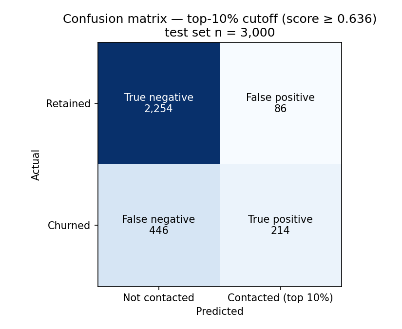
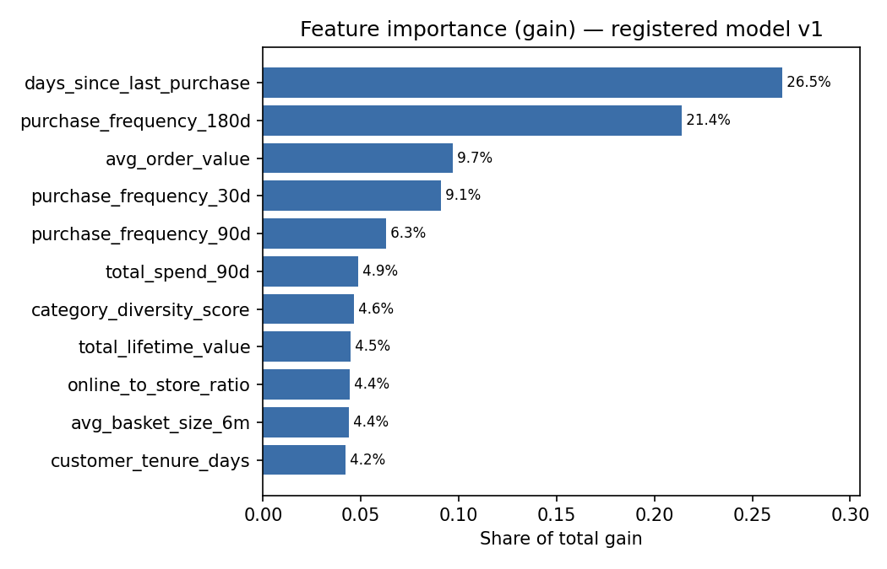

# Lab 3 — Model Design

**Track choice:** Track A (churn, required) + Track B (offer generation RAG).

---

## 1. Churn model — evaluation report (Task 1)

**Provenance:** training data pulled from the Lab 2 Feature Store offline store via Athena
(deduplicated on `customer_id`, `ORDER BY customer_id`); 9,999 customers, 6,999 train / 3,000 test,
`seed=42`, `test_size=0.30`, stratified. Trained locally on **XGBoost 3.4.1** (reference figures are 3.2.0).
Registered as `northstar-churn-models` v1, status `PendingManualApproval`.

| Metric | Value | Threshold |
|---|---|---|
| AUC-ROC (test set) | 0.7802 | reported, not thresholded |
| Precision @ top 10% | 0.7133 | ≥ 0.50 |
| Recall @ top 10% | 0.3242 | ≥ 0.25 (ceiling ≈ 0.45) |
| Recency-only baseline AUC | 0.7235 | — |
| AUC lift over baseline | +0.0567, 95% CI [0.0381, 0.0756] | CI must exclude zero |

- I made sure to use class weighting through scale_pos_weight to set it to 3.545 giving the smaller class more weight.
- I used -1 as the default imputation value for the data since upon investigatation it appeared that there were no missing values present in the data.
- `churn_risk_score` excluded from features, so no with/without comparison is needed.

### Experiment tracking
- MLflow App `northstar-mlflow`, experiment `northstar-churn`, 4 runs.

The following values were retrieved from the completed MLflow runs. All four
logged XGBoost 3.4.1, `eta=0.1`, a maximum of 200 rounds, `min_child_weight=5`,
`subsample=0.8`, and `colsample_bytree=0.8`. Their recency-only baseline AUC was
0.7235. Precision and recall use the top-10% contact budget.

| Run | `max_depth` | `scale_pos_weight` | AUC | Precision @10% | Recall @10% | AUC lift vs baseline | 95% CI for lift |
|---|---:|---:|---:|---:|---:|---:|---|
| `xgb-d6-eta0.1` | 6 | 3.545 | 0.7786 | 0.6967 | 0.3167 | +0.0551 | [0.0361, 0.0737] |
| `xgb-d3-eta0.1` | 3 | 3.545 | 0.7802 | 0.7133 | 0.3242 | +0.0567 | [0.0381, 0.0756] |
| `xgb-d6-spw1` | 6 | 1.0 | **0.7839** | **0.7233** | **0.3288** | +0.0604 | [0.0408, 0.0797] |
| `xgb-d3-final` (registered) | 3 | 3.545 | 0.7802 | 0.7133 | 0.3242 | +0.0567 | [0.0381, 0.0756] |

With class weighting held constant, reducing depth from 6 to 3 slightly improved
AUC, precision, and recall. At depth 6, removing the extra churn-class weight
(`scale_pos_weight=1.0`) produced the highest observed values for all three
metrics. Thus, class weighting did not improve these measured metrics in the
depth-6 comparison; class imbalance alone does not establish that weighting is
the better choice.

The registered model is the weighted depth-3 run, which uses shallower trees but
has an AUC 0.0037 below the best observed run. It is therefore not the
highest-scoring configuration in this experiment. The final run repeats the
earlier depth-3 result: these are four runs covering three distinct
configurations. All configurations beat the recency baseline with lift
confidence intervals above zero. Those intervals compare each model with the
baseline; they do not establish that the small differences between
configurations are statistically significant.

### Confusion matrix (top-10% cutoff, score ≥ 0.636)

Looking at this graph it seems that it was difficult to reduce the false positive rate even though we were able to identify a large portion of the negatives. This shows the issue of the imbalance of the data, it makes our model appear better because it simply can predict no contact and generally it is correct.

### Feature importance

| Feature | Normalized gain importance |
|---|---:|
| Days since last purchase (recency) | 26.5% |
| Purchase frequency over 180 days | 21.4% |
| Average order value | 9.7% |
| Purchase frequency over 30 days | 9.1% |
| Purchase frequency over 90 days | 6.3% |
| Total spend over 90 days | 4.9% |
| Category diversity score | 4.6% |
| Total lifetime value | 4.5% |
| Online-to-store ratio | 4.4% |
| Average basket size over six months | 4.4% |
| Customer tenure in days | 4.2% |

Recency and 180-day purchase frequency together account for **47.9% of the
normalized gain importance**, approximately half. Recency measures how long it
has been since a customer's last purchase; 180-day frequency measures how often
they purchased over the previous six months. Together, they are the model's
strongest signals in this importance ranking: recent activity and longer-term
purchasing habits help distinguish customers who churn from those who stay.

The table uses XGBoost's `gain` importance: the average improvement in the
training objective from tree splits using each feature, normalized so the
feature scores sum to 100%, matching the accompanying plot. Thus, 47.9% describes
this importance measure; it does not mean those two features explain half of
customer churn or half of test-set accuracy. Average order value and 30-day
purchase frequency also have substantial importance. The remaining features
rank lower, but these scores alone do not establish that they are useless;
correlated features can share signal. Removing feature groups and reevaluating
would be needed to measure their incremental contribution.

### Slice evaluation by loyalty tier

| Tier | n | Churners | AUC | Recall @10% | Note |
|---|---|---|---|---|---|
| Bronze | 1,071 | 361 | 0.7575 | 0.4598 | |
| Silver | 1,139 | 226 | 0.7099 | 0.1726 | weakest tier |
| Gold | 483 | 52 | 0.7473 | 0.1154 | |
| Platinum | 307 | 21 | 0.8703 | 0.1429 | too few churners to conclude from |

- Silver is the weakest tier because it has the lowest recall meaning there are many false positives. The common sense reason for this that since silver is the middle tier it is likely that they are not as likely to churn yet less faithful than the gold and platinum tiers and thus are harder to predict.

---

## 2. LLM system (Task 2)

Track B is implemented in `rag/`, with operating instructions and the run-record
contract in [rag-implementation.md](rag-implementation.md). Bedrock Titan V2
embeddings feed a local persistent FAISS index. Generation uses the Haiku 4.5
inference profile. Live offers read the existing online Feature Store, score its
features with the saved XGBoost model, and derive top categories from the saved
Lab 2 purchase history. The supplied four evaluation profiles remain separate
fixtures because their ground truths do not describe current online records.

The 400-token section-aware chunks have 60-token overlap within sections and
repeat document titles and table headers. Benefits, constraints, and combined
retrieval are implemented and evaluated. Combined retrieval uses metadata to
prioritize policy coverage; no additional neural reranker is used. Source files,
embedding settings, and chunking determine the persisted index version.

Observed failure modes and fixes:

1. Semantic retrieval selected tier protection and unrelated regional return
   sections while omitting points terms and shipping restrictions. Combined
   retrieval now prioritizes benefit tables, tier definitions, points/credit,
   shipping thresholds, return fees, final-sale exclusions, and retention terms.
2. Generated copy invented non-expiring points, urgency, or unrestricted returns.
   The runtime prompt now requires precise policy wording and a concise invitation;
   validation rejects several common failures, retries once, then records a
   conservative fallback if necessary. This is not complete semantic verification.
3. Feature-store tier is based on lifetime value, while policy uses trailing
   12-month qualifying spend. Tier-dependent benefits are conditional unless
   independently verified; no near-upgrade claim is inferred from lifetime value.
4. Evaluation originally supplied policy-only evidence to a faithfulness judge
   even though generation also received customer facts. Returned contexts now
   include the actual request and allowlisted profile, alongside retrieved policy.
   Ground truths are never passed into generation. Judge prompts/reasons are saved
   so incorrect judgments can be distinguished from actual offer errors.

The marketing template's three planted errors were corrected: Gold ends at
$4,999.99, Platinum begins at $5,000, and free expedited shipping exists at no tier.
No new discount or promotion is authorized by this implementation: incentives
reference existing policy benefits. The system does not claim a gear credit is
unused without a balance source.

Run artifacts are stored locally under `evaluation_results/rag/<run-id>/`.
They include configuration, exact prompt, case evidence/answers, metrics, judge
reasoning, and failure status; they are not automatically uploaded or logged to
MLflow. Reviewed aggregate evidence is in `rag-evaluation-summary.json`.

### Measured results (2026-10-17)

The three-strategy comparison used the same prompt hash and index version for
all three rows. All scores are observed means over the four supplied cases.

| Retrieval strategy | Faithfulness | Answer relevancy | Context recall |
|---|---:|---:|---:|
| Benefits | 0.301 | 0.269 | 0.783 |
| Constraints | 0.304 | 0.386 | 0.400 |
| Combined | 0.257 | 0.282 | 0.783 |
| Target | ≥0.80 | ≥0.75 | ≥0.70 |

Benefits/combined covered the ground truths better than constraint-only retrieval,
but none of these variants passed all targets. Combined remains the default for
explicit entitlement and restriction coverage, not because these measurements
establish it as the best-scoring strategy.

Subsequent prompt revisions and source-title preservation were evaluated
separately. The default run before benefit selection, `20261017T185906029909Z_7ecc20ff`, scored
**faithfulness 0.370, answer relevancy 0.269, context recall 0.783**, with one
fallback among four cases. Mean measured retrieval/generation/validation latency
was **3.23 seconds** (range 2.10–5.18 seconds), excluding customer/index loading
and judging. The two-second response target is therefore not met.

An intermediate concise-prompt run scored 0.643 / 0.331 / 0.783. A separate
Sonnet-judge run scored 0.454 / 0.298 / 0.721; it also regenerated offers, so this
is not an isolated comparison of judge models. These results show that quality
is not yet stable and that selecting the highest observed run would be misleading.

The saved judge traces include both actual issues (unqualified points claims,
invented urgency, and insufficient tier conditions) and questionable judgments
(e.g. treating a category recommendation or general points rate applied to a
qualifying category as unsupported). No thresholds, ground truths, or metric
implementations were changed to force a pass. Six local tests pass; index creation/reuse and
a live Feature Store → saved churn model → purchase categories → Bedrock offer
have also been exercised successfully.

### Benefit selection rerun

`rag/benefits.py` now resolves candidate incentives from the indexed policy table,
checks supporting sources, and selects one before copy generation. Every plan
records the selected benefit, conditional/verified tier eligibility, conditions,
exclusions, citations, source chunk IDs, and selection reason. Points values are
read from policy with a base-rate check; uncertain annual credit/birthday,
shipping, and purchase-time return eligibility cannot be invented by the model.

Application code renders the selected benefit sentence unchanged. The model
writes only a category invitation; it cannot select or rewrite the incentive.
Supporting original passages are added if semantic search omitted them. Plans
are not used as self-supporting evidence for the judge. Each case trace preserves
the plan, generated invitation, validation, and final composed offer.

Run `20261017T194346155184Z_9652e31d` used the same four fixtures, Haiku generator
and judge, Titan embeddings, index version, and RAGAS metrics as the previous
default run. Selection and the invitation-only prompt changed together.

| Measure | Before selection | With selection | Target |
|---|---:|---:|---:|
| Faithfulness | 0.370 | 0.583 | ≥0.80 |
| Answer relevancy | 0.269 | 0.276 | ≥0.75 |
| Context recall | 0.783 | 0.783 | ≥0.70 |
| Mean pipeline latency | 3.23 s | 2.28 s | <2 s response target |
| Fallback cases | 1/4 | 0/4 | reported |

The selected incentives were Gold gear repair, Bronze standard points, Platinum
early access, and Silver standard points. Eleven local tests pass, and a live
Feature Store offer was also generated. This small, single-run comparison shows
improved measured faithfulness and lower latency, but does not establish a
statistically reliable improvement or meet all targets. Generated invitation
language still added claims such as discovering what is new; invitation checks
are heuristic and do not prove semantic correctness. Additional work on copy
validation and relevance remains necessary.

### Structured claim validation

Step 2 is implemented in `rag/claims.py`. Generation returns exactly benefit ID,
category, eligibility condition (tier, verification status, and conditions), and
offer text. Bedrock's native JSON-schema mode supplies the transport structure;
application validation binds those fields to the policy-backed selection and
checks the visible text. A valid envelope cannot change the selected benefit,
upgrade a tier, omit a condition, use a different category, or add another promise.

The approved benefit sentence and a small set of category invitation templates
define allowed copy. This deliberately trades free-form wording for enforceable
claim control: unsupported language such as "discover what's new" is rejected
even when the metadata looks valid. One correction attempt is allowed; fallback
copy is validated through the same contract. Metadata is retained in the run
record; only offer text is returned to the customer.

Prompt-only JSON was evaluated first in run `20261017T200844543756Z_d3b00624`.
All four model responses used Markdown fences and were rejected, including on
retry. Its scores (0.650 / 0.264 / 0.783) therefore describe fallback copy, not
successful structured generation. That evidence is retained rather than treated
as a model-generation success. Native JSON-schema output then passed a four-case
generation-only run with zero fallbacks (`20261017T215901669706Z_e3e97172`).

The API decoder uses one stable schema across customers, allowing grammar reuse.
Customer-specific authorization remains an application check; the decoder's
allowed tier/benefit enums do not themselves authorize any of those values.
Eighteen tests pass, including forged eligibility, changed rates, unknown fields,
category/copy mismatch, malformed/duplicate JSON, retry, and validated fallback.

The final judged native-JSON run is `20261017T220131980979Z_431e3aa4`. All four
model responses passed the application contract on their first attempt: four
accepted cases, zero rejected responses, and zero fallbacks. A separate live
Feature Store offer also passed without fallback. The generator, judge, index,
test fixtures, and RAGAS metrics remain the same as the step-1 comparison.

| Measure | Step 1: selected benefit | Step 2: structured validation | Target |
|---|---:|---:|---:|
| Faithfulness | 0.583 | 0.650 | ≥0.80 |
| Answer relevancy | 0.276 | 0.264 | ≥0.75 |
| Context recall | 0.783 | 0.783 | ≥0.70 |
| Mean pipeline latency | 2.28 s | 3.43 s | <2 s response target |
| Fallback cases | 0/4 | 0/4 | reported |

Structured validation improves measured faithfulness in this run and prevents
several classes of unauthorized claims by construction, but it does not establish
source policy correctness or satisfy all quality targets. Relevance decreased
slightly, and the larger structured response increased observed mean latency.
The small sample and single rerun do not establish statistical significance.
This stage changes the delivery contract and narrows allowed wording; it is not
evidence that semantic relevance or customer response has been solved. Full
responses, schema contracts, errors, accepted payloads, judge reasoning, and
per-case timing remain in the local run folders.

---

## 3. Design justification (Task 3, ~700 words)

### Why gradient boosting
Gradient boosting is generally better than any other classic machine learning method (learning regression, support vector machines). Neural networks can be better when we have much more data to use as the neural network can learn features from data that are hard to create by hand. But in this case it is all easily interpretable tabular data so gradient boosting makes sense.

### What the features bought
- TODO: baseline vs full model, size of the lift; which features carried signal vs decorative.

### LLM system choice

RAG fits policy-grounded offer generation because the relevant knowledge is a
small, changing policy corpus. Updating and re-indexing a document is simpler and
more auditable than retraining a model to memorize policy. Fine-tuning would not
by itself provide current evidence, fix missing customer inputs, or resolve the
feature-store tier mismatch. A fixed retrieval/generation pipeline is sufficient;
this task does not require an agent to modify customer accounts or issue benefits.

Titan embeddings and local FAISS keep the lab deployment small and avoid an
always-on vector service. Haiku is the initial cost-conscious generator; model
and judge IDs are configurable. The primary production risk is making an
unsupported promise because retrieval omitted a condition or the customer tier
was stale. Conditional wording, source-preserving chunks, checks, and recorded
evaluation reduce that risk but do not eliminate it. Measured quality and latency
must meet their targets before treating this implementation as production-ready.

### With 10× the time or data
I think it would be worthwile to try cross fold validation with both the churn model and the RAG system. Generally, it is non trivial to figure out what values these hyperparameters should have.
